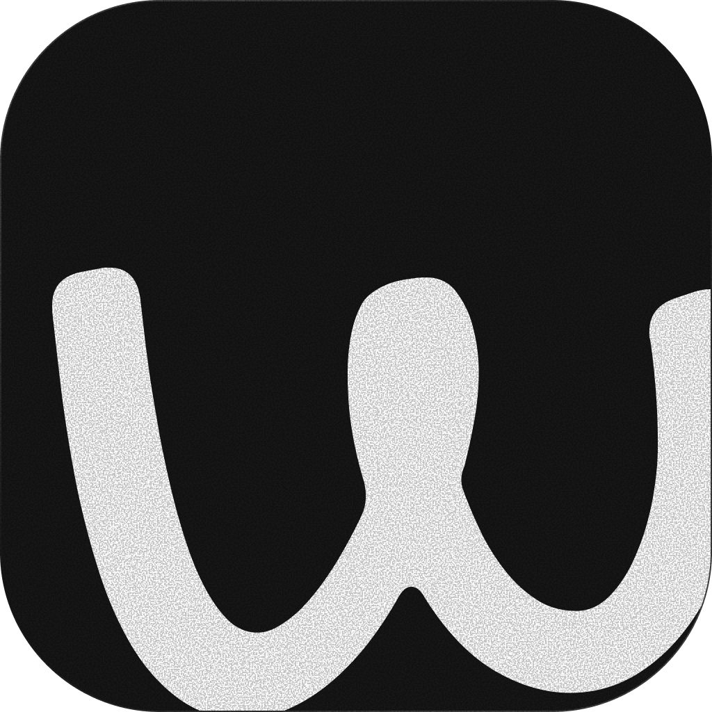

<div align="center">
  
  <h1>WriteMd</h1>
  <p><strong>Your notes. Plain Markdown. On your machine.</strong></p>
  <p>
    <a href="CHANGELOG.md">Changelog</a> ·
    <a href="https://github.com/danieldamilola/WriteMd/issues">Report an issue</a> ·
    <a href="LICENSE">MIT license</a>
  </p>
</div>

WriteMd is a desktop Markdown editor for writing, organizing notes, and working with an optional AI assistant. Open a file where it already lives, or start a note in your vault. Your documents stay ordinary Markdown files you can open in other editors.

Writing and file management work offline without a WriteMd account. There is no built-in cloud storage or sync.

<!-- Add the new, approved screenshots here when supplied. Do not reuse the previous UI screenshots. -->

## Project status

Download the [Windows installer](https://github.com/danieldamilola/WriteMd/releases/latest) from Releases. WriteMd is in active development. Android is not available yet; other platforms can be built from source using the instructions below.

Desktop packaging is configured for Windows, macOS, and Linux. An Android version is not available yet.

## Write and edit

- Live Markdown editing, source mode, and a reading view.
- Headings, lists, task lists, tables, syntax-highlighted code, math, Mermaid diagrams, and YAML frontmatter.
- Wiki links and backlinks for moving between connected notes.
- Paste or drop images into a note. Images are saved beside the document in an `_assets` folder and linked with relative paths.
- Find and replace with case, whole-word, and regular-expression controls.
- Export to PDF, standalone HTML, or Word. The export preview includes page size, margins, and theme controls.

## Organize your workspace

Choose horizontal tabs or a vertical sidebar. Pin notes, reorder them, and arrange them into Space groups with names and icons. Groups can contain other groups; dragging them changes the workspace organization without moving files on disk.

When the sidebar is collapsed, its group icons open searchable folder cards. Browse notes and nested groups, create a note, or add a subgroup while the sidebar stays closed.

Open a second pane for another document, your vault files, backlinks, or export preview. Resize the panes to suit your work. Themes, fonts, accent colors, local backgrounds, background effects, and supported window materials are configurable in Settings.

## An assistant when you need one

Use the floating bar for a question or an edit near your text, or open the AI chat panel for a longer conversation. Both views share the conversation, so you can move between them without starting again.

The assistant supports:

- Questions, summaries, rewrites, and edits to notes, including files outside the vault.
- Selected text, `@` file references, and attachments as context.
- Personal writing instructions selected with `/skill-name`.
- Saved conversations, streamed replies, Stop, Retry, and undo for recorded file changes.
- Model selection and per-model reasoning and service-tier choices where supported.
- Web search when the selected model supports tools.

The floating bar previews proposed edits before you accept them, unless **Automatically accept AI edits** is enabled. The chat panel can apply edits directly. Changes are checked against newer document content before they are applied.

### Connect a provider

Open **Settings > AI assistant**, choose a provider, connect it, and fetch its available models.

- **API-key providers:** OpenAI, Anthropic, Gemini, OpenRouter, DeepSeek, Groq, Mistral, and xAI, plus compatible endpoints.
- **Account connections:** ChatGPT and OpenCode use browser sign-in. ChatGPT supports multiple saved accounts and switching from the chat panel.
- **Local models:** Ollama and LM Studio can connect through their local server endpoints.

Available models, usage limits, and service tiers depend on the provider and your account. Signing in does not unlock models restricted to a provider's own application.

### Add your own skills

Open **Settings > AI assistant > Skills > Open skills folder**. Add a Markdown instruction file, or a folder containing `SKILL.md`, then select it by typing `/` at the start of a prompt.

```text
Your vault/
  Skills/
    proofread.md
    outline/
      SKILL.md
```

Skill files can be up to 256 KB. WriteMd reads their instructions; it does not execute scripts from them. See [Personal AI skills](docs/ai-skills.md) for examples.

## Where your files go

New notes use `~/Documents/WriteMd Vault/` by default. Change the vault location and new-note defaults in Settings. If the default filename is already in use, WriteMd chooses an unused name.

Existing documents open and save in their original locations. You do not need to import them into the vault. Autosave is enabled by default, and `Ctrl+S` saves immediately. Writes use a temporary file and rename rather than writing directly over the original. External changes refresh clean documents; conflicting changes are surfaced for review.

Workspace preferences, recent files, open tabs, and group organization are stored in the app's local settings. AI credentials are stored separately from those preferences.

## Keyboard controls

Shortcuts can be changed in **Settings > Keyboard shortcuts**. The defaults include:

- `Ctrl+N`, `Ctrl+O`, `Ctrl+S`: new note, open file, save.
- `Ctrl+Shift+S`: save as.
- `Ctrl+P` or `Ctrl+K`: command palette.
- `Ctrl+F`, `Ctrl+H`: find and replace.
- `Ctrl+E`: switch between reading and live editing.
- `Ctrl+B`: show or hide the sidebar.
- `Ctrl+Alt+S`: toggle the second pane.
- `Ctrl+Shift+E`, `Ctrl+Shift+B`: show files or backlinks in the second pane.
- `Ctrl+Alt+A`: open the floating AI bar.
- `Ctrl+J` or `Ctrl+Alt+Shift+A`: open the AI chat panel.
- `Alt+J`: AI actions for selected text.
- `Ctrl+,`: Settings.

On macOS, use Command for Ctrl and Option for Alt. Export commands are available in the document menu and command palette.

## Privacy and network access

WriteMd has no built-in telemetry or analytics. Editing does not require a network connection.

When you send an AI request, the configured provider receives the context needed for that request. This can include your message, the open document or selection, conversation history, referenced or attached files, selected skill instructions, and file content returned by assistant tools. Cloud AI providers handle that data under their own policies. Local inference is available through local providers.

Browser sign-in and model discovery contact the selected provider. Web search sends a search query to DuckDuckGo. Update checks and downloads contact GitHub; automatic checks can be disabled in Settings.

Saved API keys and account tokens use the operating system's encryption support and stay outside `config.json`. If secure storage is unavailable, credentials are kept for the current app session instead of being saved in plaintext. See [PRIVACY.md](PRIVACY.md) for details.

## Run from source

Use Node.js **24.15.0** and **pnpm 9** to match the repository's CI configuration.

```bash
git clone https://github.com/danieldamilola/WriteMd.git
cd WriteMd
pnpm install --frozen-lockfile
pnpm dev
```

Local builds show a **Development** badge in the title bar. Packaged builds hide it.

Run the checks:

```bash
pnpm typecheck
pnpm lint
pnpm test
pnpm build
pnpm test:e2e
```

The Electron checks use temporary profiles and vaults. To build an installer on the target operating system, run the corresponding command:

```bash
pnpm build:win
pnpm build:mac
pnpm build:linux
```

Packaged artifacts are written to `dist/`. macOS builds are currently unsigned and unnotarized. Release instructions are in [docs/releasing.md](docs/releasing.md).

## Working on WriteMd

The app uses Electron, strict TypeScript, and Lit Web Components. CodeMirror 6 handles editing, markdown-it handles Markdown rendering, and the renderer accesses system features through a typed preload bridge.

- `src/main/`: files, exports, updates, AI requests, and credential storage.
- `src/preload/`: the Electron bridge.
- `src/renderer/`: editor, components, state, and themes.
- `src/shared/`: shared types, settings schema, and export helpers.
- `tests/`: unit and Electron checks.

Read [AGENTS.md](AGENTS.md) for development rules, [the PRD](docs/PRD.md) for product decisions, and [the roadmap](docs/phases.md) for ongoing work. User-visible changes belong in [CHANGELOG.md](CHANGELOG.md).

## Credits and license

WriteMd is MIT licensed. Its interface includes adaptations from MonoCode and OpenCode, and bundled provider marks from Lobe Icons. See [LICENSE](LICENSE), [third-party notices](THIRD_PARTY_NOTICES.md), and the [license files](licenses/).
